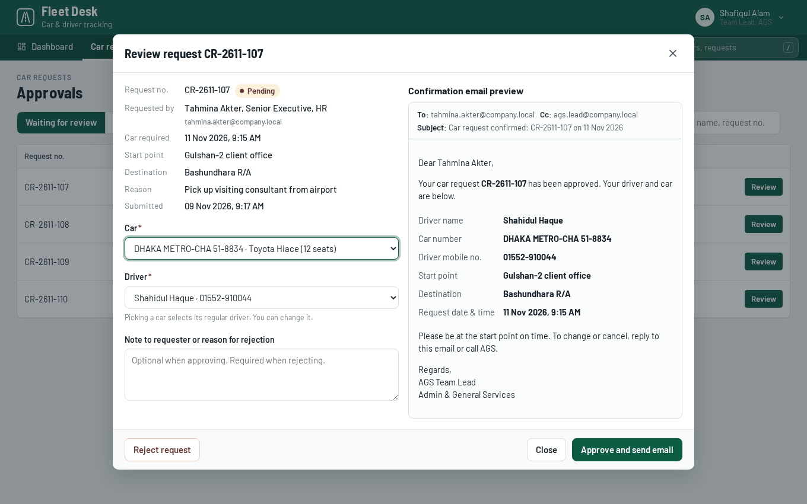
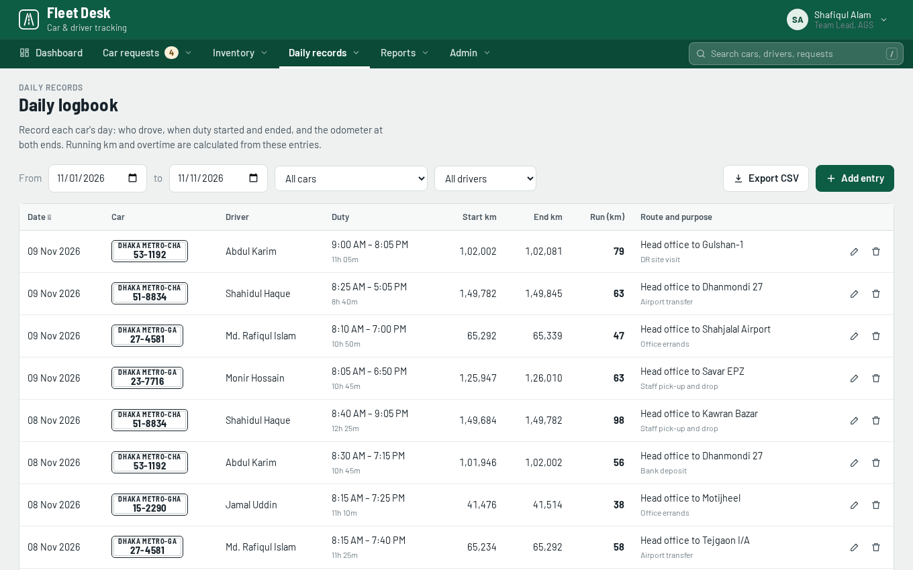
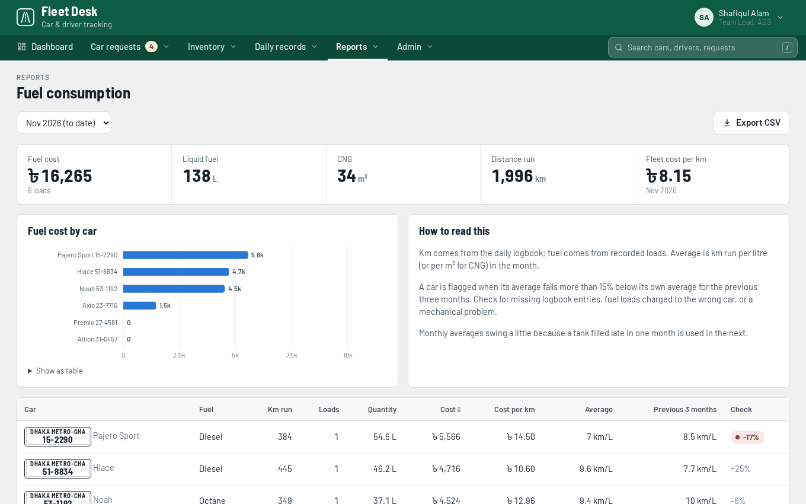
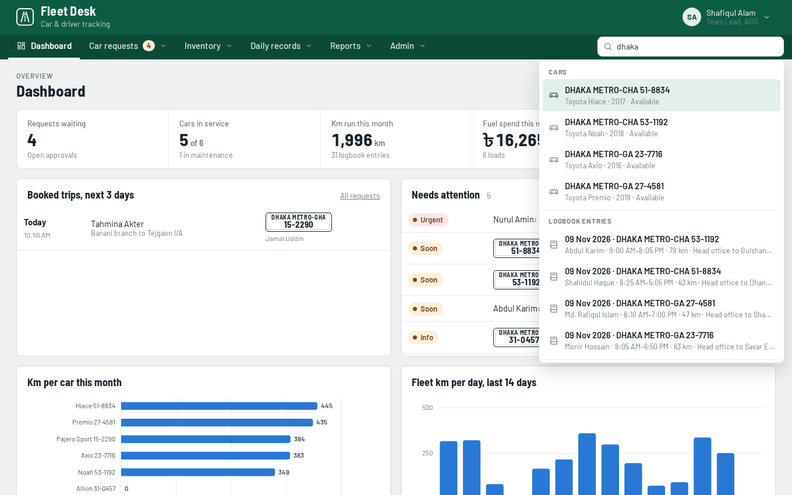
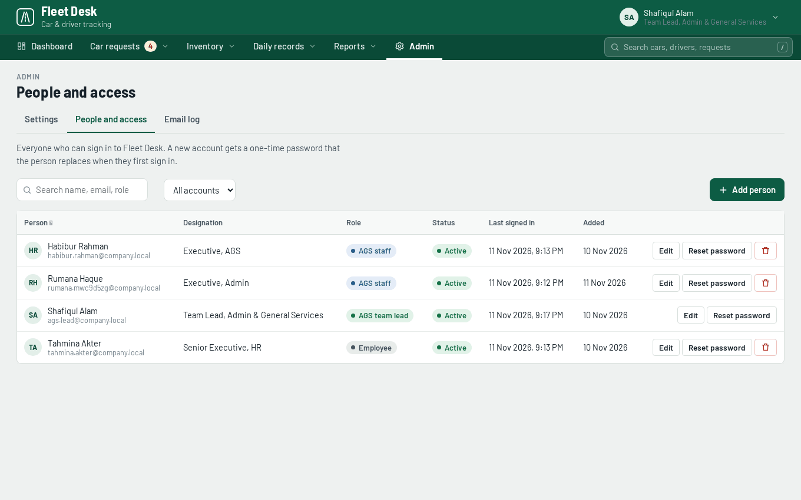
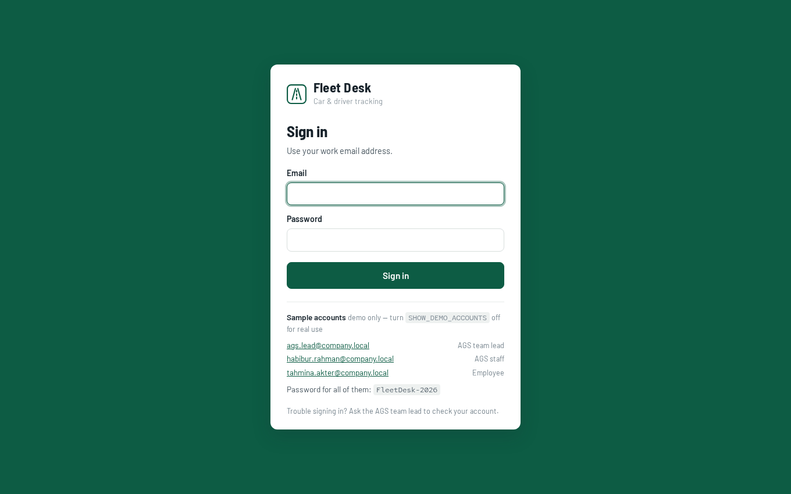
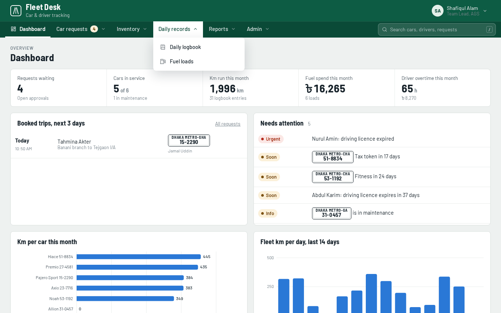
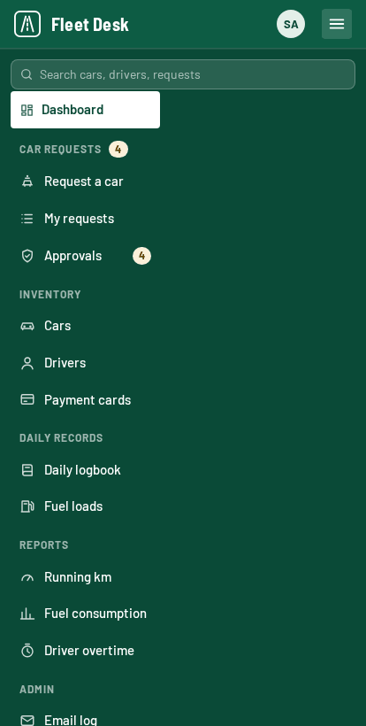

# Fleet Desk: car and driver tracking

Tracks cars, drivers, fuel and payment cards, and handles employee car requests with
team-lead approval. Three containers: the **frontend** (Nginx serving plain HTML, CSS
and ES modules), the **backend** (Node REST API), and the **database** (PostgreSQL).
A fourth, Mailpit, catches the emails the app sends so you can read them without a
mail relay.

Nothing is loaded from the internet at runtime — the fonts are bundled — so it works
on an isolated network.


## What's in it

| Page | Who sees it | Covers |
|---|---|---|
| Request a car | Everyone | Requisition form: name, designation, email, date, start point, destination, starting time, reason |
| My requests | Everyone | The user's requests and their status, the confirmation email they received, and calling off a trip themselves — while it is still waiting, or after approval right up until it starts, which frees the car and driver and tells AGS why |
| Approvals | AGS staff (view), team lead (act) | Review a request, pick car and driver (clashes within 3 hours are flagged), preview and send the confirmation email, or reject with a reason |
| Dashboard | AGS | Which cars are on trip, available or in maintenance and which drivers are on duty, free or on leave right now; waiting requests; trips booked for the next 3 days; expiring papers and licences; spend against each card's monthly limit; km charts |
| Cars | AGS | Car inventory, regular driver, fuel card, papers expiry (fitness, tax token, insurance) |
| Drivers | AGS | Driver inventory, licence expiry, OT rate, this month's duty days and overtime |
| Payment cards | AGS | Card inventory (last 4 digits only), spending against the monthly limit, and the full fuel-load history per card |
| Daily logbook | AGS | One entry per car per day: driver, duty start and end, odometer at start and end |
| Fuel loads | AGS | Every refuel with the card used, plus a by-card summary |
| Running km | AGS | Km per car by week and by month |
| Fuel consumption | AGS | Fuel and cost per car per month, km/L, cost per km, and a flag when efficiency drops |
| Driver overtime | AGS | Overtime per driver per month with a day-by-day breakdown |
| Assignment history | AGS | Which driver took which car over any period — days driven and km from the logbook, trips booked through approved requests, and whether each pairing is the car's regular driver or cover |
| Admin → Email log | AGS | Every email sent (to the team lead, confirmations, rejections, cancellations), why any of them failed, and a way to send it again |
| Admin → Settings | Team lead | Approval contacts, shift and overtime rules, weekend days, holidays, fuel prices, mail server |
| Admin → People and access | Team lead | Who can sign in, their role, and resetting a password |

Admin is one page with those three as tabs; each tab has its own address, so
`#admin/users` and the search box both land straight on it.

Tables can be sorted and exported to CSV; reports can be printed.

The top menu groups these pages by category. Its search box (`/` or Ctrl-K from
anywhere) looks through the pages you can open and the records you are allowed to
see — car requests, cars, drivers, payment cards, logbook entries and fuel loads —
then opens the right page with its filters already set to the match. A logbook entry
from three months ago opens the logbook on that day and that car, even though the
page normally starts on the current month. An employee's search covers only their
own requests. It runs in the browser over the lists the app already loads; for a much
larger fleet, move it behind a search endpoint on the API.

## Screens

| | |
|---|---|
| [](docs/screenshots/approve-request.png) | [](docs/screenshots/logbook.png) |
| **Approving a request** — assign the car and driver, with clashes flagged, and read the confirmation email exactly as the requester will get it. | **Daily logbook** — one entry per car per day. Running km and driver overtime are worked out from these. |
| [](docs/screenshots/fuel-consumption.png) | [](docs/screenshots/search.png) |
| **Fuel consumption** — km per litre against each car's own three-month average, with a flag when efficiency drops. | **Search** — one box over pages, cars, drivers, cards, requests, logbook entries and fuel loads. |
| [](docs/screenshots/people-and-access.png) | [](docs/screenshots/sign-in.png) |
| **People and access** — who can sign in and what they may do, managed by the team lead. | **Signing in** — accounts and roles, or hand identity over to an SSO proxy. |
| [](docs/screenshots/menu.png) | [](docs/screenshots/mobile-menu.png) |
| **Navigation** — pages grouped by category in the top menu. | **On a phone** — the menu becomes a drawer, and tables scroll. |

## Start the whole stack

Needs Docker with the Compose plugin (`docker compose version`).

```bash
cp .env.example .env          # optional: ports, password, timezone
docker compose up -d --build
```

| What | Where |
|---|---|
| The app | http://localhost:8080 |
| Emails it sends | http://localhost:8025 (Mailpit) |
| API, for curl and tests | http://127.0.0.1:8081/api/v1 (loopback only) |

The database starts empty, creates its schema from `db/init/`, and the API loads the
sample fleet — 7 drivers, 6 cars, 5 cards, three months of logbook and fuel entries,
and a requisition history dated relative to today. Data lives in the `pgdata` volume
and survives `docker compose down`.

Sign in with one of the sample accounts — the sign-in page lists them, and they all
use the password `FleetDesk-2026`:

| Account | Role | Sees |
|---|---|---|
| `ags.lead@company.local` | AGS team lead | Everything, including approvals, settings and accounts |
| `habibur.rahman@company.local` | AGS staff | Inventory, logbook, fuel and reports |
| `tahmina.akter@company.local` | Employee | Requesting a car and following their own requests |

Change that password and turn `SHOW_DEMO_ACCOUNTS` off before anyone real uses this —
see [Before real use](#before-real-use).

```bash
docker compose ps                      # health of each container
docker compose logs -f backend         # API log
docker compose down                    # stop, keep the data
docker compose down -v                 # stop and delete the database volume
```

## How the pieces fit

```
browser ──▶ frontend (Nginx :8080)
              ├── /            index.html, assets/   (static files)
              └── /api/   ──▶  backend (Node :8080)  ──▶  db (PostgreSQL :5432)
                                   └── SMTP ──▶ mail (Mailpit :1025, UI :8025)
```

The browser only ever talks to the frontend; the API and the database are not
published off the host. The frontend decides where its data comes from at runtime
from `<meta name="fleetdesk-mode">` in `index.html`, which the frontend container
rewrites on start — so the same files serve both the container stack (`api`) and the
browser-only demo (`mock`).

The email templates, the overtime and running-km rules, and the demo data generator
are shared: `backend/scripts/sync-shared.mjs` copies `assets/js/{utils,calc,email,seed}.js`
into `backend/src/shared/` when the API image is built. The confirmation email the
team lead previews before approving is rendered by the same module that sends it.

### Settings

All defaults work without a `.env`.

| Variable | Default | What it does |
|---|---|---|
| `WEB_PORT` | `8080` | Host port for the app |
| `API_PORT` | `8081` | Host port for the API, bound to 127.0.0.1 |
| `MAIL_UI_PORT` | `8025` | Host port for Mailpit's web UI |
| `POSTGRES_DB` / `POSTGRES_USER` / `POSTGRES_PASSWORD` | `fleetdesk` | Database name and credentials |
| `TZ` | `Asia/Dhaka` | Timezone for dates, times and `createdAt` |
| `FLEETDESK_MODE` | `api` | `api` uses the backend; `mock` serves the browser-only demo |
| `AUTH_MODE` | `password` | `password` uses Fleet Desk's own sign-in page; `proxy` trusts an SSO proxy |
| `SESSION_HOURS` | `12` | How long a signed-in session survives without use |
| `SHOW_DEMO_ACCOUNTS` | `true` | Lists the three sample accounts on the sign-in page |
| `DEMO_PASSWORD` | `FleetDesk-2026` | The password the sample accounts are seeded with |
| `ADMIN_EMAIL` / `ADMIN_PASSWORD` | — | Create your own team lead instead of the samples |
| `SEED_DEMO_DATA` | `true` | Loads the sample fleet, but only into an empty database |
| `SMTP_HOST` / `SMTP_PORT` | `mail` / `1025` | Mail relay. Point at your own and drop the `mail` service |
| `MAIL_RETRY_SECONDS` | `300` | How often failed emails are retried |

## Accounts

Everyone who uses Fleet Desk has an account, and the role on it decides what they see.
The **AGS team lead** manages them under **Admin → People and access**: add someone,
change their role, disable an account, or reset a password. A new account gets a
one-time password, shown once, which the person has to replace the first time they
sign in — until they do, nothing else opens for them.

Everyone can open **My account** from the user menu in the top-right to fix their own
name and designation, change their password, and see — and end — the sessions they
have open elsewhere.

Starting with an empty database and no sample data, set `ADMIN_EMAIL` (and optionally
`ADMIN_PASSWORD`) and the first start creates that team lead; without `ADMIN_PASSWORD`
a one-time password is printed to the API log:

```bash
docker compose logs backend | grep '\[accounts\]'
```

Passwords are stored as scrypt hashes and never leave the server. Sessions live in the
database, so disabling an account, changing someone's role, or resetting a password
signs that person out everywhere at once.

## Mail

Fleet Desk emails the team lead when a request comes in, the requester when it is
approved, rejected or cancelled. Where it sends from is set in two places:

- **Settings → Mail server**, by the team lead: server address, port, encryption,
  username, password and sender name, with a **Send a test email** button that reports
  back exactly what the server said — including the error, when there is one. The
  password is stored on the server and never returned by the API, to anyone.
- **The container environment** (`SMTP_HOST`, `SMTP_PORT`, `SMTP_SECURE`, `SMTP_USER`,
  `SMTP_PASS`), which is what a fresh deployment uses until somebody fills the form in.
  Clearing the server address on the Settings page hands control back to it.

Common relays:

| Relay | Address | Port | Encryption |
|---|---|---|---|
| Microsoft 365 | `smtp.office365.com` | 587 | STARTTLS |
| Google Workspace | `smtp.gmail.com` | 587 | STARTTLS |
| A company relay that needs no sign-in | its hostname | 25 | None |
| Mailpit, in this compose file | `mail` | 1025 | None |

Every message is written to the `outbox` table before it is sent, so nothing is lost
when the relay is down: the **Email log** shows the delivery state with the reason a
message failed, offers **Send again**, and a background worker retries failures on its
own every `MAIL_RETRY_SECONDS`.

## Everyday operations

```bash
# Reload the sample data from scratch (deletes everything else)
docker compose exec backend node src/seed.js --force

# End-to-end check of the API: CRUD, validation, roles, the approval workflow, reports
docker compose exec backend npm run smoke

# Back up and restore
docker compose exec -T db pg_dump -U fleetdesk fleetdesk | gzip > fleetdesk-$(date +%F).sql.gz
gunzip -c fleetdesk-2026-11-10.sql.gz | docker compose exec -T db psql -U fleetdesk -d fleetdesk

# Open a SQL prompt
docker compose exec db psql -U fleetdesk -d fleetdesk
```

`npm run smoke` creates records, checks the rules reject what they should, and deletes
what it can — it is safe against the demo database, and it leaves one driver and a few
requisitions behind (reload the sample data to clear them).

After changing anything under `assets/` or `backend/src/`, rebuild:
`docker compose up -d --build`.

## Before real use

- **Accounts.** Set `SHOW_DEMO_ACCOUNTS=false`, create your own team lead with
  `ADMIN_EMAIL`, and delete or disable the three sample accounts under **People and
  access**. If you keep them, change `DEMO_PASSWORD` first.
- **Single sign-on (optional).** Set `AUTH_MODE=proxy` and put an authenticating proxy
  in front (oauth2-proxy, mod_auth_openidc, Keycloak) that sets `X-Forwarded-Email` and
  `X-Forwarded-Groups`. Fleet Desk then stops managing passwords and maps the groups in
  `ROLE_GROUP_LEAD` and `ROLE_GROUP_AGS` onto team lead and AGS staff, treating everyone
  else as an employee. Only do this where that proxy is the only route to the API: the
  headers are trusted completely. See `backend/src/auth.js`.
- **TLS.** Terminate it at the ingress in front of the frontend container, or use
  `deploy/fleetdesk.conf` as the pattern. The frontend container speaks plain HTTP on
  8080 and sets the security headers itself. Over HTTPS the session cookie is marked
  Secure automatically; `COOKIE_SECURE=true` forces it.
- **Password.** Change `POSTGRES_PASSWORD` before the first start (it is baked into the
  volume at initialisation) and keep `.env` out of version control.
- **Mail.** Point Fleet Desk at the company relay — **Settings → Mail server**, or
  `SMTP_HOST`/`SMTP_PORT` — and remove the `mail` service, which exists only to catch
  demo mail. See [Mail](#mail).
- **Card data.** Only the last four digits of a card are ever accepted or stored. The
  column has a check constraint to keep it that way.

## Deploy without containers (RHEL 10.x)

The frontend alone runs on plain Nginx with no Node.js on the server:

```bash
tar xzf fleet-frontend.tar.gz && cd fleet-frontend
sudo bash deploy/install-rhel10.sh fleet.yourdomain.local
```

The script installs Nginx, copies the site to `/var/www/fleetdesk`, sets the SELinux
context (`httpd_sys_content_t`), turns on `httpd_can_network_connect` for the API
proxy, creates a self-signed certificate if none exists, installs
`deploy/fleetdesk.conf`, and opens http/https in firewalld. Replace the self-signed
certificate with one from your internal CA.

Served this way the app starts in `mock` mode (data in the browser). To use the API,
run the backend and database — containers, or Node 22 and PostgreSQL 17 directly —
uncomment the `location /api/` block in `/etc/nginx/conf.d/fleetdesk.conf`, and set
the meta tag in `/var/www/fleetdesk/index.html` to `api`.

To update later, copy the new `index.html` and `assets/` into `/var/www/fleetdesk` and
run `restorecon -R /var/www/fleetdesk`.

## Project layout

```
docker-compose.yml           The four services
.env.example                 Ports, credentials, behaviour

index.html                   App shell
login.html                   Sign-in page
assets/css/app.css           All styles
assets/fonts/                Barlow (SIL Open Font License)
assets/js/app.js             Router, navigation, roles, who is signed in
assets/js/api.js             Data layer: mock (localStorage) or REST
assets/js/calc.js            Overtime and running-km rules
assets/js/email.js           Email templates (request, confirmation, rejection)
assets/js/seed.js            Demo data and default settings
assets/js/ui.js              Tables, forms, modals, charts, toasts
assets/js/utils.js           Formatting and date helpers
assets/js/login.js           Sign-in page logic
assets/js/views/*.js         One file per page

frontend/Dockerfile          Nginx image (unprivileged, port 8080)
frontend/nginx.conf          Static files, security headers, /api/ proxy
frontend/entrypoint/         Sets the data mode from FLEETDESK_MODE

backend/Dockerfile           API image (Node 22)
backend/src/server.js        Express app and startup
backend/src/config.js        Environment settings
backend/src/db.js            PostgreSQL pool and type parsing
backend/src/schema.js        Field registry: columns, types, uniqueness
backend/src/store.js         Generic CRUD and the business rules
backend/src/auth.js          Identity and role checks
backend/src/password.js      scrypt hashing and password rules
backend/src/sessions.js      Session store and cookie
backend/src/migrate.js       Applies db/migrations at startup
backend/src/settings.js      The settings document
backend/src/mailer.js        Outbox, SMTP delivery, retries
backend/src/seed.js          Loads the sample fleet
backend/src/routes/          auth, users, me, settings, requisitions, reports, collections
backend/src/shared/          Generated copy of the shared frontend modules
backend/test/smoke.js        End-to-end API test

db/migrations/*.sql          Schema, applied in order by the API at startup
docs/screenshots/            The images in this README
deploy/                      Nginx config and RHEL 10 install script (no containers)
API_CONTRACT.md              What the backend provides
```

## Defaults you may want to change (Settings page)

- Shift 9:00 AM to 6:00 PM, 15-minute grace, overtime rounded down to 30 minutes
- Weekend Friday and Saturday, paid at 1.5×; weeks start Sunday
- Fuel prices: placeholders. Set them to the current government rates

## License

Fleet Desk is released under the [MIT License](LICENSE).

The bundled Barlow fonts are not covered by it. They are licensed separately under
the SIL Open Font License, included as `assets/fonts/OFL-LICENSE.txt`.
